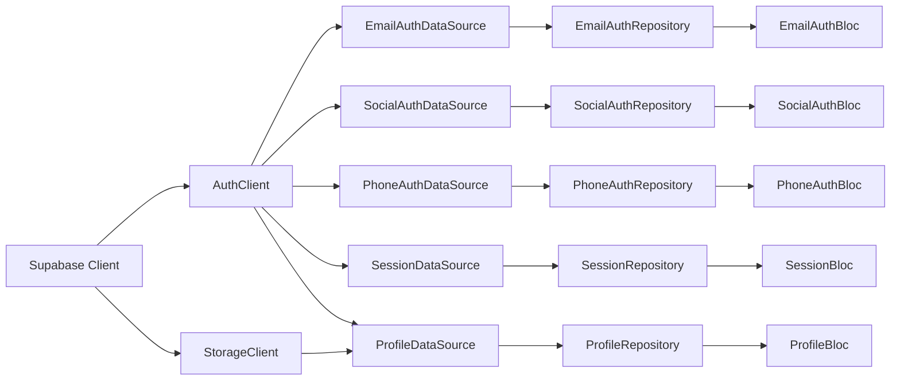
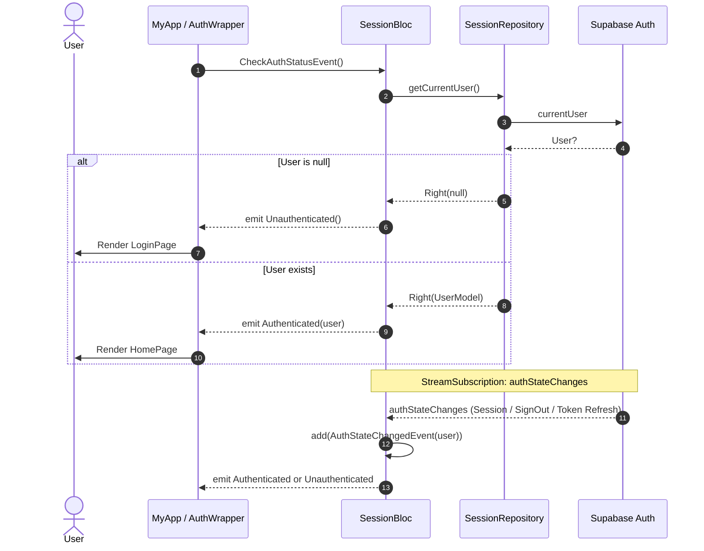
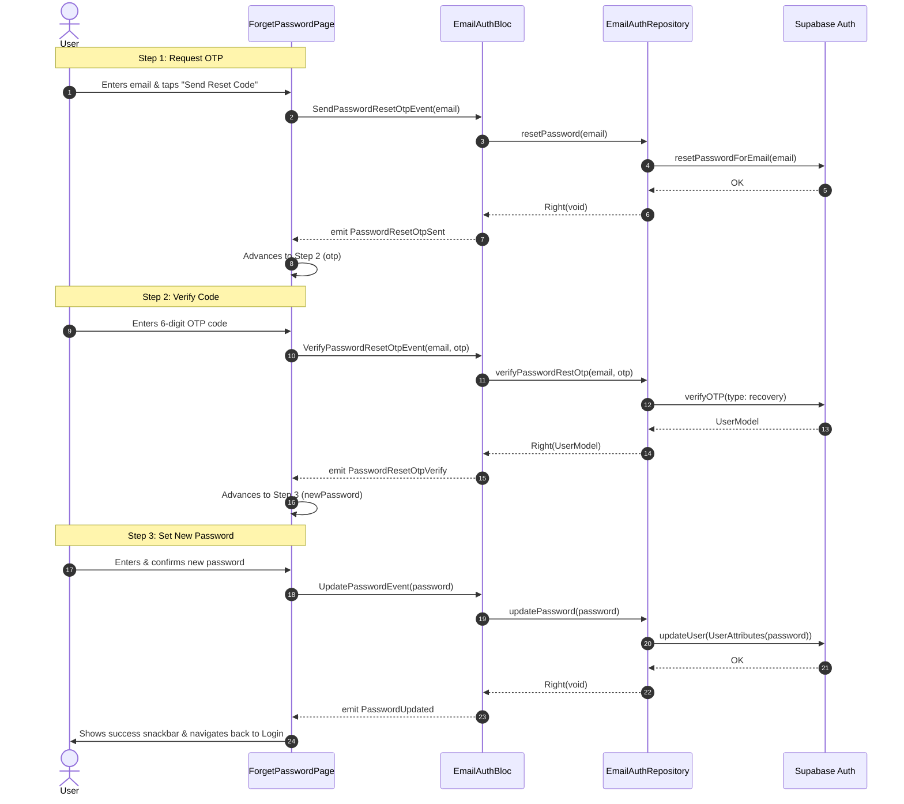

# Authentication & Profile Feature (`lib/features/auth`)

Comprehensive documentation for the Authentication and Profile feature in `auth_flow_app`. This module implements a multi-method authentication system and profile management suite built with **Flutter**, **Supabase**, and **Clean Architecture** powered by the **BLoC** pattern.

---

## Table of Contents
1. [Architectural Overview](#architectural-overview)
2. [Folder & File Structure](#folder--file-structure)
3. [Domain Layer](#domain-layer)
   - [Entities](#entities)
   - [Repository Interfaces](#repository-interfaces)
4. [Data Layer](#data-layer)
   - [Models](#models)
   - [Data Sources](#data-sources)
   - [Repository Implementations](#repository-implementations)
5. [Presentation Layer](#presentation-layer)
   - [BLoCs, Events & States](#blocs-events--states)
   - [Screens & Views](#screens--views)
   - [Step & Sub-Components](#step--sub-components)
6. [Dependency Injection & Service Locator](#dependency-injection--service-locator)
7. [Authentication & Data Flows](#authentication--data-flows)
   - [1. Global Session & Auth State Management](#1-global-session--auth-state-management)
   - [2. Multi-Step Forgot Password Flow](#2-multi-step-forgot-password-flow)
   - [3. Profile Avatar Upload & Cache Busting](#3-profile-avatar-upload--cache-busting)
8. [Error Handling Strategy](#error-handling-strategy)

---

## Architectural Overview

This feature strictly adheres to **Clean Architecture** principles and **Domain-Driven Design (DDD)**:

```mermaid
flowchart TD
    subgraph Presentation ["Presentation Layer (Flutter & BLoC)"]
        UI[Screens & Widgets]
        BLoC[BLoC / State Management]
        UI -->|Dispatches Events| BLoC
        BLoC -->|Emits States| UI
    end

    subgraph Domain ["Domain Layer (Business Logic)"]
        RepoInterfaces[Repository Interfaces]
        Entities[Entities]
    end

    subgraph Data ["Data Layer (Data & Infrastructure)"]
        RepoImpl[Repository Implementations]
        DataSources[Data Sources: Remote / Supabase]
        Models[Models & Serializers]
    end

    subgraph External ["External Services"]
        SupabaseAuth[Supabase Auth]
        SupabaseStorage[Supabase Storage]
        SupabaseFunctions[Edge Functions: delete-account]
        GoogleSignIn[Google Sign-In SDK]
    end

    BLoC -->|Calls| RepoInterfaces
    RepoImpl -.->|Implements| RepoInterfaces
    RepoImpl -->|Calls| DataSources
    DataSources -->|Transforms to/from| Models
    Models --|> Entities
    DataSources -->|Communicates with| External
```

- **Domain Layer**: Independent from Flutter and external frameworks. Contains pure entity models and abstract repository contracts.
- **Data Layer**: Implements repository contracts, handles remote Supabase clients, serializes JSON/Supabase objects into models, and manages storage.
- **Presentation Layer**: Encapsulates UI screens and BLoCs. Reacts to user inputs, triggers events, and rebuilds UI based on state changes.

---

## Folder & File Structure

```
lib/features/auth/
├── data/
│   ├── datasources/
│   │   ├── email_auth_datasource.dart            # Contract for email/password auth
│   │   ├── email_auth_datasource_impl.dart       # Supabase implementation for email auth
│   │   ├── phone_auth_datasource.dart            # Contract for SMS OTP phone auth
│   │   ├── phone_auth_datasource_impl.dart       # Supabase implementation for phone auth
│   │   ├── profile_datasource.dart               # Contract for profile & avatar management
│   │   ├── profile_datasource_impl.dart          # Supabase storage & metadata update implementation
│   │   ├── session_datasource.dart               # Contract for current user session & stream
│   │   ├── session_datasource_impl.dart          # Supabase session & authStateChanges implementation
│   │   ├── social_auth_datasource.dart           # Contract for OAuth / third-party providers
│   │   └── social_auth_datasource_impl.dart      # Google, GitHub, and Apple auth implementation
│   ├── models/
│   │   └── user_model.dart                       # UserModel (extends UserEntity) with Supabase mapper
│   └── repositories/
│       ├── email_auth_repository_impl.dart       # Email repository with Either<Failure, T> wrapping
│       ├── phone_auth_repository_impl.dart       # Phone repository with Either<Failure, T> wrapping
│       ├── profile_repository_impl.dart          # Profile repository with Either<Failure, T> wrapping
│       ├── session_repository_impl.dart          # Session repository with Either<Failure, T> wrapping
│       └── social_auth_repository_impl.dart      # Social repository with Either<Failure, T> wrapping
│
├── domain/
│   ├── entities/
│   │   └── user_entity.dart                      # Core User business object (Equatable)
│   └── repositories/
│       ├── email_auth_repository.dart            # Domain contract for email actions
│       ├── phone_auth_repository.dart            # Domain contract for SMS OTP actions
│       ├── profile_repository.dart               # Domain contract for profile actions
│       ├── session_repository.dart               # Domain contract for session actions
│       └── social_auth_repository.dart           # Domain contract for third-party OAuth actions
│
└── presentation/
    ├── bloc/
    │   ├── email_auth/
    │   │   ├── email_auth_bloc.dart              # Handles signup, signin, reset password, magic link
    │   │   ├── email_auth_event.dart
    │   │   └── email_auth_state.dart
    │   ├── phone_auth/
    │   │   ├── phone_auth_bloc.dart              # Handles sending OTP and verifying phone OTP
    │   │   ├── phone_auth_event.dart
    │   │   └── phone_auth_state.dart
    │   ├── profile/
    │   │   ├── profile_bloc.dart                 # Handles avatar upload, profile updates, account deletion
    │   │   ├── profile_event.dart
    │   │   └── profile_state.dart
    │   ├── session/
    │   │   ├── session_bloc.dart                 # Global auth state listener & sign out
    │   │   ├── session_event.dart
    │   │   └── session_state.dart
    │   └── social_auth/
    │       ├── social_auth_bloc.dart             # Google, GitHub, Apple OAuth flows
    │       ├── social_auth_event.dart
    │       └── social_auth_state.dart
    └── screens/
        ├── login_screen.dart                     # Main entry screen (Email, Password, Social, Nav)
        ├── signup_screen.dart                    # Registration screen (Name, Email, Password)
        ├── phone_auth_screen.dart                # Phone number entry + 6-digit OTP step screen
        ├── forget_password_screen.dart           # 3-step password recovery wizard
        ├── profile_screen.dart                   # Profile editing, photo picker & upload, account deletion
        ├── home_screen.dart                      # Authenticated dashboard with user info & logout
        └── components/
            └── forget_password/
                ├── email_step_widget.dart        # Step 1: Input email & request OTP
                ├── otp_step_widget.dart          # Step 2: Input 6-digit verification code
                └── new_password_step_widget.dart # Step 3: Enter and confirm new password
```

---

## Domain Layer

The domain layer contains high-level business rules and entities independent of external packages or databases.

### Entities

#### [`UserEntity`](lib/features/auth/domain/entities/user_entity.dart)
Represents the authenticated user within the application domain.
- **Fields**:
  - `id`: `String` - Unique user UUID.
  - `email`: `String` - User's primary email address.
  - `displayName`: `String?` - User's full name / profile name.
  - `photoUrl`: `String?` - URL pointing to the user's avatar image.
  - `phoneNumber`: `String?` - Registered phone number (if any).
  - `isEmailVerified`: `bool` - Email verification status.
  - `createdAt`: `DateTime` - Account creation timestamp.
- **Equality**: Extends `Equatable` for value comparison.

### Repository Interfaces

All domain repositories return `Future<Either<Failure, T>>` (or synchronous `Either` where appropriate) using `dartz` to force callers to handle both error and success paths.

1. **[`EmailAuthRepository`](lib/features/auth/domain/repositories/email_auth_repository.dart)**
   - `signUpWithEmail({email, password, name})`: Creates a new user account with metadata.
   - `signInWithEmail({email, password})`: Authenticates an existing user.
   - `resetPassword({email})`: Sends password reset OTP to email.
   - `verifyPasswordRestOtp({email, otp})`: Validates the recovery OTP code.
   - `updatePassword({password})`: Sets a new password after successful verification.
   - `sendMagicLink({email})`: Sends passwordless authentication magic link.

2. **[`PhoneAuthRepository`](lib/features/auth/domain/repositories/phone_auth_repository.dart)**
   - `sendOTP({phoneNumber})`: Requests SMS OTP for the specified phone number.
   - `verifyOTP({phoneNumber, otpCode})`: Validates SMS OTP code and returns authenticated `UserEntity`.

3. **[`SocialAuthRepository`](lib/features/auth/domain/repositories/social_auth_repository.dart)**
   - `signInWithGoogle()`: Native Google Sign-In with ID token Supabase authentication.
   - `signInWithApple()`: Apple OAuth placeholder.
   - `signInWithGitHub()`: Supabase browser OAuth redirect flow.

4. **[`SessionRepository`](lib/features/auth/domain/repositories/session_repository.dart)**
   - `getCurrentUser()`: Synchronously checks current authenticated user from local session.
   - `signOut()`: Logs out current user from Supabase session.
   - `authStateChanges`: `Stream<UserEntity?>` that broadcasts session changes in real-time.

5. **[`ProfileRepository`](lib/features/auth/domain/repositories/profile_repository.dart)**
   - `updateProfile({displayName, photoUrl})`: Updates metadata (`name`, `custom_avatar_url`).
   - `uploadProfilePicture({filePath})`: Uploads image to Supabase Storage bucket (`avatars`) and updates profile metadata.
   - `deleteAccount()`: Triggers backend account deletion via Edge Function.

---

## Data Layer

The data layer handles data retrieval, mapping, network requests, and external libraries.

### Models

#### [`UserModel`](lib/features/auth/data/models/user_model.dart)
Extends `UserEntity` with serialization logic:
- `UserModel.fromSupabaseUser(User user)`:
  - Intelligently extracts avatar with fallback precedence:
    1. `user.userMetadata?['custom_avatar_url']` (custom uploaded photo)
    2. `user.userMetadata?['avatar_url']` (Google / OAuth photo)
    3. `user.userMetadata?['photo']`
  - Extracts display name from `user.userMetadata?['name']`.
  - Determines verification state via `user.confirmationSentAt != null`.
- `UserModel.fromJson(Map<String, dynamic> json)` / `toJson()`: Standard JSON serialization.
- `copyWith(...)`: Immutable copy helper for updating user fields.

### Data Sources

All datasources communicate through abstract network clients (`AuthClient`, `StorageClient`):

1. **[`EmailAuthDataSourceImpl`](lib/features/auth/data/datasources/email_auth_datasource_impl.dart)**
   - Interacts with `_authClient.signUp(...)`, `_authClient.signIn(...)`, `_authClient.resetPasswordForEmail(...)`, `_authClient.verifyPasswordResetOTP(...)`, and `_authClient.updatePassword(...)`.
   - Maps errors to `AuthException` or `ServerException`.

2. **[`PhoneAuthDataSourceImpl`](lib/features/auth/data/datasources/phone_auth_datasource_impl.dart)**
   - Triggers `_authClient.signInWithOtp(phoneNumber)` and `_authClient.verifyOtp(...)`.

3. **[`SocialAuthDataSourceImpl`](lib/features/auth/data/datasources/social_auth_datasource_impl.dart)**
   - Integrates `GoogleSignIn` with `serverClientId` for web/mobile token exchange.
   - Calls `_authClient.signInWithIdToken(OAuthProvider.google, idToken)`.
   - Uses `_authClient.signInWithOAuth(OAuthProvider.github, callbackUrl)` for browser-based OAuth.

4. **[`SessionDataSourceImpl`](lib/features/auth/data/datasources/session_datasource_impl.dart)**
   - Inspects `_authClient.currentUser`.
   - Streams user changes using `_authClient.authStateChanges.map(...)` mapping `session?.user` into `UserModel`.

5. **[`ProfileDataSourceImpl`](lib/features/auth/data/datasources/profile_datasource_impl.dart)**
   - **`updateProfile`**: Preserves existing metadata and updates `name` and `custom_avatar_url`.
   - **`uploadProfilePicture`**: Uploads image to `avatars` bucket under path `$userId/avatar_$timestamp.$fileExt`, obtains public URL, and writes URL to `user_metadata.custom_avatar_url`.
   - **`deleteAccount`**: Calls `_authClient.deleteAccount()`, which triggers the Supabase Edge Function `delete-account`.

### Repository Implementations

Located in `lib/features/auth/data/repositories/`:
- `EmailAuthRepositoryImpl`
- `PhoneAuthRepositoryImpl`
- `SocialAuthRepositoryImpl`
- `SessionRepositoryImpl`
- `ProfileRepositoryImpl`

Each repository catches `AuthException` and `ServerException` and translates them into `AuthFailure` or `ServerFailure`:
```dart
try {
  final userModel = await dataSource.signInWithEmail(...);
  return Right(userModel);
} on AuthException catch (e) {
  return Left(AuthFailure(e.message));
} on ServerException catch (e) {
  return Left(ServerFailure(e.message));
}
```

---

## Presentation Layer

The presentation layer manages UI components and state using `flutter_bloc`.

### BLoCs, Events & States

| BLoC | Key Events | Key States | Responsibility |
|---|---|---|---|
| **`SessionBloc`** | `CheckAuthStatusEvent`<br>`SignOutEvent`<br>`AuthStateChangedEvent`<br>`UpdateCurrentUserEvent` | `SessionInitial`<br>`SessionLoading`<br>`Authenticated(user)`<br>`Unauthenticated`<br>`SessionError(message)` | Global authentication session manager. Subscribes to Supabase auth stream on startup and handles app-level routing. |
| **`EmailAuthBloc`** | `SignUpWithEmailEvent`<br>`SignInWithEmailEvent`<br>`SendPasswordResetOtpEvent`<br>`VerifyPasswordResetOtpEvent`<br>`UpdatePasswordEvent`<br>`SendMagicLinkEvent` | `EmailAuthInitial`<br>`EmailAuthLoading`<br>`EmailAuthSuccess(user)`<br>`EmailAuthError(message)`<br>`PasswordResetOtpSent(message, email)`<br>`PasswordResetOtpVerify`<br>`PasswordUpdated(message)` | Handles all email/password operations and the 3-step password reset workflow. |
| **`PhoneAuthBloc`** | `SendOTPEvent`<br>`VerifyOTPEvent` | `PhoneAuthInitial`<br>`PhoneAuthLoading`<br>`OTPSent(phoneNumber)`<br>`PhoneAuthSuccess(user)`<br>`PhoneAuthError(message)` | Manages sending and verifying 6-digit SMS verification codes. |
| **`SocialAuthBloc`** | `SignInWithGoogleEvent`<br>`SignInWithAppleEvent`<br>`SignInWithGitHubEvent` | `SocialAuthInitial`<br>`SocialAuthLoading`<br>`SocialAuthSuccess(user)`<br>`SocialAuthLaunched`<br>`SocialAuthError(message)` | Manages Google Native Sign-In, GitHub web flow, and Apple Sign-In. |
| **`ProfileBloc`** | `UpdateProfileEvent`<br>`UploadProfilePictureEvent`<br>`DeleteAccountEvent` | `ProfileInitial`<br>`ProfileLoading`<br>`ProfileUpdated(user)`<br>`ProfilePictureUploaded(photoUrl)`<br>`AccountDeleted`<br>`ProfileError(message)` | Handles profile changes, avatar uploads to Supabase Storage, and account deletion. |

---

### Screens & Views

1. **[`LoginPage`](lib/features/auth/presentation/screens/login_screen.dart)** (`/login`):
   - Injected with `EmailAuthBloc` and `SocialAuthBloc`.
   - Provides text fields with validation for Email and Password.
   - Social auth buttons: Google (`SignInWithGoogleEvent`), GitHub (`SignInWithGitHubEvent`), and Apple.
   - Action links: "Forgot Password?", "Phone Sign In", and "Create Account".
   - `MultiBlocListener` automatically routes to `/home` upon successful sign-in.

2. **[`SignupPage`](lib/features/auth/presentation/screens/signup_screen.dart)** (`/signup`):
   - Injected with `EmailAuthBloc`.
   - Form fields: Full Name, Email, Password, Confirm Password.
   - Validates password length (>= 6 chars) and confirmation match.
   - On success, navigates to `/home`.

3. **[`PhoneAuthPage`](lib/features/auth/presentation/screens/phone_auth_screen.dart)** (`/phone-auth`):
   - State machine using `PhoneAuthStep` enum (`phone` -> `otp`).
   - Uses `pinput` widget for 6-digit OTP code entry.
   - Back button dynamically navigates back to the phone step if on the OTP step.

4. **[`ForgetPasswordPage`](lib/features/auth/presentation/screens/forget_password_screen.dart)** (`/forgot-password`):
   - Wizard with 3 discrete steps:
     1. `EmailStepWidget`: Enter email & request OTP.
     2. `OtpStepWidget`: Enter 6-digit code received via email (using `pinput`).
     3. `NewPasswordStepWidget`: Enter and confirm new password.
   - Uses `BlocConsumer<EmailAuthBloc, EmailAuthState>` to advance steps sequentially.

5. **[`HomePage`](lib/features/auth/presentation/screens/home_screen.dart)** (`/home`):
   - Displays user avatar with cache-busting timestamp (`?t=...`).
   - Displays Display Name, Email, and Email Verification status badge (`Chip`).
   - Actions: Edit Profile button (`/profile`) and Logout button (`SignOutEvent`).
   - Re-routes to `/login` if `SessionBloc` becomes `Unauthenticated`.

6. **[`ProfilePage`](lib/features/auth/presentation/screens/profile_screen.dart)** (`/profile`):
   - Avatar image with camera overlay button.
   - Modal bottom sheet allowing Camera or Gallery selection via `image_picker`.
   - MD5 hash caching via `crypto` and `SharedPreferences` to avoid re-uploading identical photos.
   - Displays user email (read-only) and editable display name.
   - "Delete Account" button with confirmation alert dialog calling `DeleteAccountEvent`.
   - Propagates updated user model back to `SessionBloc` via `UpdateCurrentUserEvent`.

---

## Dependency Injection & Service Locator

All dependencies are wired together in [`lib/core/di/injection_container.dart`](lib/core/di/injection_container.dart) using `get_it`:



- **Singletons (`registerLazySingleton`)**:
  - `AuthClient`, `StorageClient`
  - All 5 DataSources (`EmailAuthDataSource`, `SocialAuthDataSource`, `PhoneAuthDataSource`, `SessionDataSource`, `ProfileDataSource`)
  - All 5 Repositories (`EmailAuthRepository`, `SocialAuthRepository`, `PhoneAuthRepository`, `SessionRepository`, `ProfileRepository`)
- **Factories (`registerFactory`)**:
  - All 5 BLoCs (`EmailAuthBloc`, `SocialAuthBloc`, `PhoneAuthBloc`, `SessionBloc`, `ProfileBloc`) to ensure clean lifecycle instances per screen or session.

---

## Authentication & Data Flows

### 1. Global Session & Auth State Management

At application startup in `main.dart`, `MyApp` wraps MaterialApp with `SessionBloc` and triggers `CheckAuthStatusEvent()`:



---

### 2. Multi-Step Forgot Password Flow



---

### 3. Profile Avatar Upload & Cache Busting

To prevent stale cached avatars across re-uploads:
1. When a user picks an image from gallery/camera, an MD5 checksum is computed.
2. The file is uploaded to the Supabase `avatars` bucket under `/<userId>/avatar_<timestamp>.<ext>`.
3. The public URL is saved in Supabase `user_metadata.custom_avatar_url`.
4. The local UI appends a timestamp query param `?t=<timestamp>` to bust Flutter's `NetworkImage` image cache.
5. `UpdateCurrentUserEvent` is dispatched to `SessionBloc` so `HomePage` immediately reflects the new avatar without a reload.

---

## Error Handling Strategy

1. **Exceptions** (`lib/core/error/exceptions.dart`):
   - `AuthException`: Authentication failures (e.g. invalid credentials, expired OTP).
   - `ServerException`: Network errors or unexpected Supabase exceptions.
2. **Failures** (`lib/core/error/failures.dart`):
   - `AuthFailure`: Value failure returned on domain/presentation boundaries.
   - `ServerFailure`: Server connection or execution failure.
3. **Presentation Feedback**:
   - `BlocListener` displays user-friendly red `SnackBar` notifications with `state.message`.
   - Forms use `GlobalKey<FormState>` with real-time text input validation before dispatching BLoC events.
